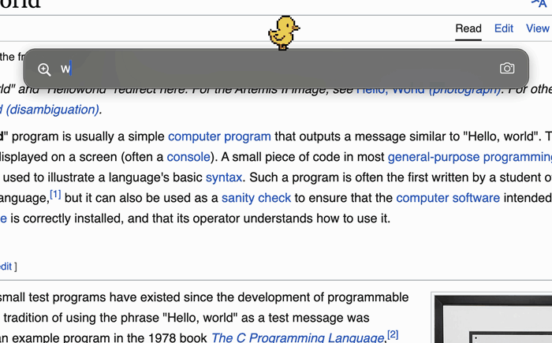
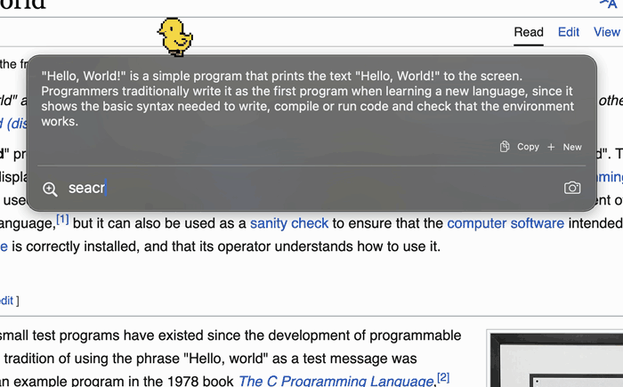
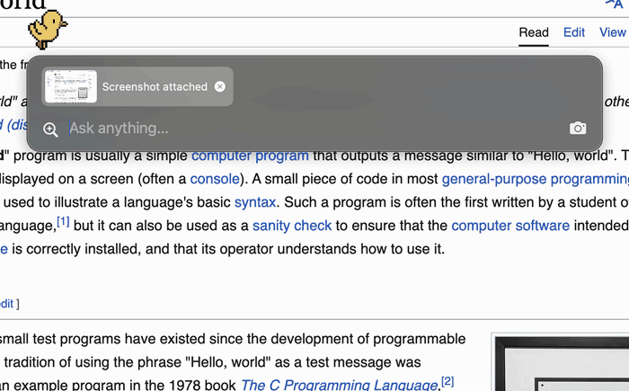
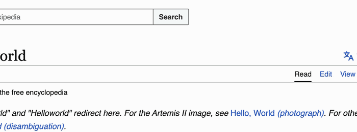

<p align="center"></p>

# QuickAsk

A tiny Mac menu-bar app for quick answers from Claude. Press **⌃M** (Control+M) in any app, type a question, and the answer streams in a small popup. Press Esc and you're back where you were.

<p align="center"></p>

- **Ask about what you're looking at:** attach a screenshot of your screen, or the text you've selected.
- **Live answers:** Claude searches the web by itself when a question needs current information (news, prices, scores).
- **Follow-up questions**, one-key copy of the answer, and an editable system prompt.
- **A pixel duck** that sits on top of the popup, and quacks when an answer is ready, even if you've closed the popup and moved on.
- **No servers, accounts or tracking.** The app talks only to Anthropic's API, using your own API key.

## See it in action
**Follow-ups and live web search.** Ask a follow-up and Claude looks it up online, with links to its sources.

<p align="center"></p>

**Ask about your screen.** Press the camera button (or ⌃⇧M) to attach a screenshot, then ask about it.

<p align="center"></p>

**And the duck.** It arrives a different way each time (running, jumping or falling in) and keeps itself busy while you type. When an answer is ready, it hops and quacks. If you close the popup while Claude is still writing, the answer keeps coming and the quack tells you it's ready. You can turn off the duck and the quack in Settings.

<p align="center"></p>

## What you need
- A Mac with **macOS 14 (Sonoma) or newer**. Built and tested on Apple Silicon; Intel Macs should work but haven't been tested.
- **Apple's Command Line Tools** (free, about 1 GB). If you don't have them, the build tells you how to install them.
- An **Anthropic API key** with some credit on it, from [console.anthropic.com](https://console.anthropic.com) → API Keys. You pay Anthropic directly for what you use. A typical question costs a fraction of a cent with the default model.

## Install
Open the **Terminal** app and run these three commands, one at a time:

```bash
git clone https://github.com/gponsa/quickask.git
```
```bash
cd quickask
```
```bash
./build.sh install
```

If your Mac says the `git` command needs the command line developer tools, click **Install**, wait for it to finish, then run the first command again.

This builds QuickAsk on your Mac, copies it to your Applications folder and starts it. Look for its icon in the menu bar. The first build takes about a minute.

The first time, the build also creates a small certificate called "QuickAsk Local Signing" in your keychain. QuickAsk is signed with it, so macOS remembers the permissions you give it when you update. If macOS asks whether `codesign` may use the key, click **Always Allow**.

**Why build it yourself?** QuickAsk isn't signed by Apple, so a downloaded copy would be blocked by macOS. Building it on your own Mac avoids that.

## First run
1. A Settings window opens. Paste your API key and click **Save**. QuickAsk checks the key with Anthropic and stores it in your Mac's Keychain, never in a file.
2. Press **⌃M** in any app and ask something.

## Keys
| Key | Action |
|---|---|
| ⌃M | open / close the popup |
| ⌃⇧M or camera button | attach a screenshot of your screen (the popup is left out) |
| Enter | send |
| Shift+Enter | new line |
| Esc / click outside | close (an answer still being written keeps coming; the duck quacks when it's ready) |
| ⌘N | new conversation (stops an answer that's still being written) |
| ⌘C (nothing selected) | copy the last answer |
| ⌘, | settings |

## Settings
Open them from the menu-bar icon → **Settings…**, or by opening QuickAsk from the Applications folder.

- **Model.** Default `claude-haiku-5-5`, the fastest and cheapest. For harder questions try `claude-sonnet-5-5`.
- **Hotkeys.** Click a shortcut and press a new one (it must include ⌃, ⌥ or ⌘). If another app already uses it, you'll see a warning and the old one stays. While QuickAsk runs, ⌃M is reserved for it everywhere. In Terminal, ⌃M normally acts as Return, so change the hotkey if that bothers you.
- **Include selected text** sends whatever text you've selected along with your question. Needs Accessibility permission (see below).
- **Search the web when needed** (on by default). About $0.01 per search, at most 3 per question. Claude only searches when the question needs it. While it searches you'll see "Searching the web for …", and the answer comes with links to its sources.
- **Keep conversation when reopening**, **Show the duck**, **Quack when an answer is ready**, **Launch at login**, and the **system prompt** that sets Claude's tone and answer length.

## Permissions
- **Hotkey:** none needed.
- **Screenshots:** Screen Recording. System Settings → Privacy & Security → Screen & System Audio Recording → turn on QuickAsk, then quit and reopen it.
- **Selected text:** Accessibility. System Settings → Privacy & Security → Accessibility → turn on QuickAsk.

QuickAsk asks for these the first time you use the feature that needs them.

## Privacy
- Your questions, plus any screenshot or selected text **you choose to attach**, go to Anthropic's API (`api.anthropic.com`) and nowhere else. Web searches also run on Anthropic's servers.
- Screenshots are taken only when you press the camera button or ⌃⇧M, and are never saved to disk.
- No analytics, no tracking, no accounts.
- Your API key lives in the macOS Keychain.

## Updating
In Terminal, inside the `quickask` folder:
```bash
git pull && ./build.sh install
```

## Troubleshooting
**Permissions stuck or not working.** Reset them, then let QuickAsk ask again:
```bash
./build.sh reset-permissions
```

**"Model not found".** Check the model name in Settings (default `claude-haiku-5-5`).

**Searches fail with "web search is not enabled".** An admin of your Anthropic organisation turned it off at platform.claude.com/settings/capabilities.

**Launch at login won't switch on.** The app must be in /Applications (`./build.sh install` puts it there).

**Uninstall.** Quit from the menu-bar icon, delete `/Applications/QuickAsk.app`, then run `./build.sh reset-permissions`. To remove your key, open Keychain Access and delete the `com.guillem.quickask` item. You can delete the "QuickAsk Local Signing" certificate there too.

## How it's built
Plain Swift (SwiftUI + AppKit) with no dependencies, compiled by `build.sh` with `swiftc`. Xcode isn't needed. The code is in `Sources/QuickAsk/`:

| File | What it does |
|---|---|
| `App.swift` | menu-bar icon, settings defaults, startup |
| `PanelController.swift` | the floating popup window |
| `ChatView.swift` / `ChatModel.swift` | the popup's UI and conversation state |
| `AnthropicClient.swift` | streaming requests to the Claude API, web search |
| `ContextCapture.swift` | screenshots and selected text |
| `HotkeyManager.swift` | global hotkeys |
| `Keychain.swift` | API key storage |
| `Duck.swift` | the duck |
| `SettingsView.swift` | the Settings window |

The duck's frames were cut from `Art/duck-mockup.png` with `Art/tools/extract_duck.py`. Its quack is `Resources/quack.wav`.

## License
MIT. See [LICENSE](LICENSE). Not affiliated with Anthropic.
